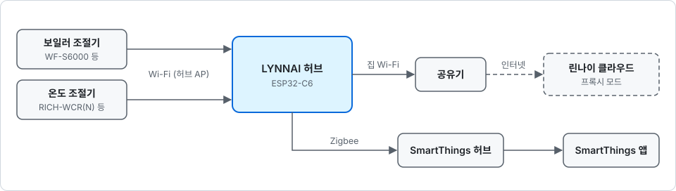
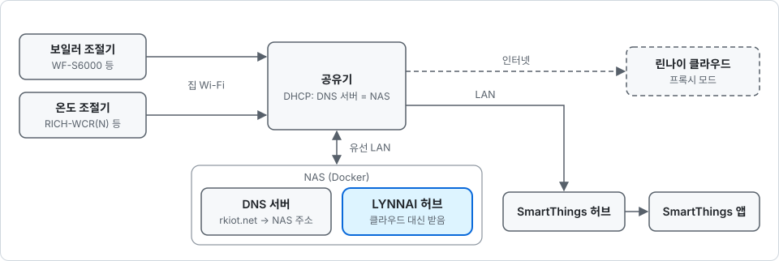
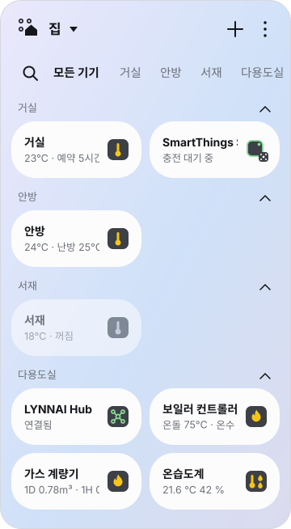
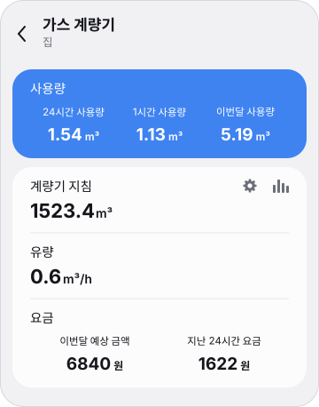
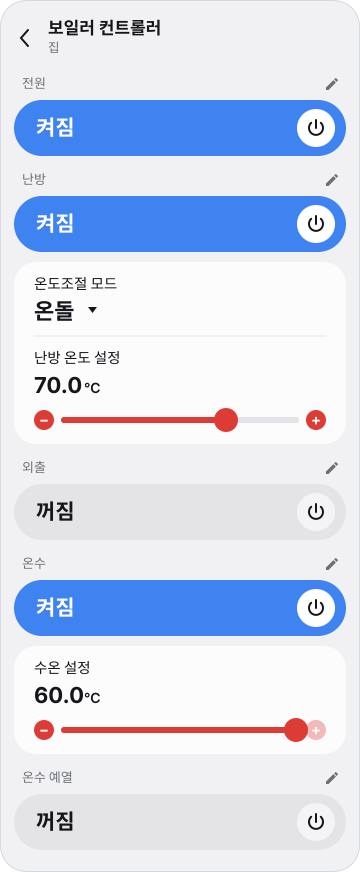
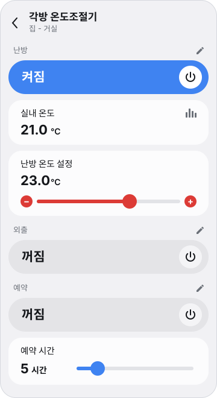
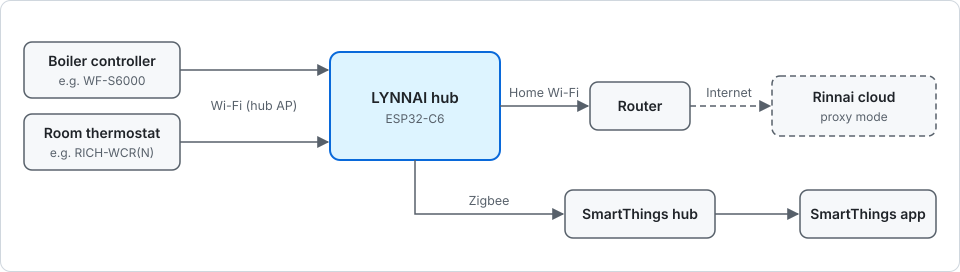

# lynnai-hub

린나이(Rinnai) 프로토콜을 쓰는 보일러 조절기·각방 온도 조절기를 **집 안에서** 제어하고 SmartThings 에 붙이는 허브.
ESP32-C6 보드 하나가 기기 입장에서의 "클라우드"가 되어, 기기를 자기 Wi-Fi(AP)로 받아 상태를 읽고 명령을 넣는다.
린나이 클라우드로 그대로 이어 주거나(프록시 모드, 린나이 앱 계속 사용) 클라우드 없이 혼자 동작한다(단독 모드).
SmartThings 와는 Zigbee(또는 LAN)로 붙는다.

> ⚠️ 리버스 엔지니어링으로 만든 **비공식** 프로젝트입니다. 린나이와 아무 관련이 없고
> 후원·보증받지 않았습니다. `lynnai` 는 상표 회피를 위한 임시 명칭입니다.
> 본인 소유 기기에 대해 본인 책임으로 사용하세요.

**ESP32 허브** — [설치·운영 안내](docs/esp32-hub.md)

**NAS 허브** (ESP32 없이 NAS 도커로) — [설치·운영 안내](docs/nas-hub.md)

**Home Assistant** — [맞춤 통합(시험판)](docs/home-assistant.md): 허브의 LAN 통로에 붙어 방·보일러·센서·가스 계량기를 올립니다.

## 빠른 시작

자세한 내용은 **[docs/esp32-hub.md](docs/esp32-hub.md)** (설치·연결·초기화·고장 분석, 빌드는 부록).

1. **펌웨어 쓰기**: ESP32-C6-DevKitC-1 에 릴리즈 이미지를 씁니다(esptool 또는 브라우저 웹 플래셔).
2. **첫 설정**: 허브가 띄우는 `LYNNAI-SETUP-…` AP 에 휴대폰으로 붙어 집 Wi-Fi·허브 AP·관리자 암호를 넣습니다.
3. **SmartThings**: 초대 링크 <https://bestow-regional.api.smartthings.com/invite/Qrjp9gnaJbMq> 로 드라이버
   *LYNNAI Hub (Zigbee)* 를 설치 → 앱에서 **기기 추가 → 주변 기기 검색** → 허브 버튼 **짧게**.
4. **린나이 기기**: 보일러·온도 조절기 Wi-Fi 모듈을 설정 모드로 두고 허브 버튼 **길게(3초)**.
   또는 린나이 스마트링크 앱에서 Wi-Fi 로 허브 AP 를 골라 등록한 뒤, 관리 화면 **등록 대기**에서 **등록**.

## 시험한 기기

| 구분 | 모델 |
|---|---|
| 보일러 제어기 | 린나이 **WF-S6000** |
| 온도 제어기 | 린나이 **RICH-WCR(N)** (각방) |
| 허브 보드 | ESP32-C6-DevKitC-1 v1.2 |
| SmartThings | SmartThings Station, 스마트 홈 허브(V4) |

다른 모델은 확인하지 않았습니다. 자세한 내용은 [docs/esp32-hub.md 1.1](docs/esp32-hub.md#11-시험한-기기).

## 주요 기능

- **SmartThings 기기**: 보일러(전원·난방 모드/방식/온도·온수·예열·예약 상태), 온도 조절기가 알려 주는 방마다
  기기(방1~방6·거실: 켜기·설정 온도·외출·예약), 온습도계, 가스 계량기. 보일러·온도 조절기 여러 대와 짝 지정 지원.
- **자동화(드라이버 내장)**: 모든 방이 꺼지면 보일러 난방을 끄고, 방이 켜지면 다시 켠다.
- **자동 단독 동작**: 프록시 모드에서 린나이 서버가 안 되면 그동안 허브가 기기를 직접 받아 스마트홈 제어가 끊기지
  않는다. 서버가 돌아오면 스스로 프록시로 돌아간다([동작 모드](#동작-모드)).
- **관리 화면** `http://<허브IP>/admin`: 동작 모드, 연결 방식(Zigbee/LAN), 연결된 기기(이름·보일러 연결·기기/방별 노출),
  종류별 노출 컨트롤, 서버 연동(API 토큰), 센서 플러그인.
- **서버 연동**: `/api/v1/state`(JSON)·`/metrics`(Prometheus)·`/api/events`·`/api/stats`, NAS 기록기 `server/lynnai-hub-watch`.
- **고장 진단**: LED 오류 코드(빨강 N번 깜빡), USB 시리얼 `diag`, PC 진단 스크립트 `tools/hub_doctor.py`.

## 스크린샷

SmartThings 앱에서 보이는 화면입니다(실제 화면을 따라 그린 그림).

<table>
  <tr>
    <td valign="top" width="33%">
      
        
      
    </td>
    <td valign="top" width="33%">
      
    </td>
    <td valign="top" width="33%">
      
    </td>
  </tr>
</table>

왼쪽 위부터 기기 목록, 그 아래 가스 계량기, 가운데 보일러 컨트롤러, 오른쪽 각방 온도조절기(방마다 하나)입니다.

## 동작 모드

- **프록시** (기본) — 기기 ↔ 허브 ↔ 린나이 클라우드를 이어 준다. 린나이 앱을 그대로 쓰면서 SmartThings 로도 제어.
  클라우드 주소는 허브가 집 Wi-Fi 쪽 DNS 로 직접 조회하고, DNS 가 준 주소들을 그 TTL 동안만 쓴다.
- **단독** — 클라우드에 붙지 않고 허브가 기기의 MQTT 상대가 된다. 인터넷이 없어도 SmartThings 로 제어되지만
  린나이 앱으로는 보이지 않는다.

관리 화면의 동작 모드 카드나 스마트홈의 허브 기기(SmartThings "모드", Home Assistant "동작 모드")에서 고르고, 바꾸면
기기가 다시 접속할 때(수십 초) 적용된다.

### 린나이 서버가 안 될 때 (자동 단독 동작)

프록시 모드는 서버가 있어야 기기가 붙는다. 그래서 서버 쪽이 **두 번 연달아 실패하면**(보통 1분 안) 허브가 그동안만
단독 모드처럼 기기를 직접 받는다. 기본으로 켜져 있고 동작 모드 카드에서 끌 수 있다.

- **무엇을 실패로 보나**: 서버가 기기의 로그인을 받아 주지 않는 모든 경우. 집 Wi-Fi 끊김, 서버 주소 조회 실패,
  연결 안 됨, 보안 연결 실패뿐 아니라 연결은 되는데 로그인을 거절하거나 답이 없거나 바로 끊는 서버도 포함한다.
- **그동안**: 스마트홈 제어는 계속되고, 린나이 앱에서는 기기가 오프라인으로 보인다(허브가 없어도 서버가 죽으면
  오프라인이다).
- **돌아가기**: 허브가 1분마다 서버에 보안 연결을 해 보고, 두 번 연달아 되면 기기를 다시 붙게 해서 프록시로 돌아간다.
  돌아갔다가 또 실패하면 확인 간격을 10분까지 늘린다.
- **어떻게 보이나**: "모드"는 **설정**이라 프록시 그대로다. 지금 실제 동작은 "상태"에 나온다 —
  `단독 모드 (18:25부터 린나이 서버 연결 안 됨)`처럼 언제부터·왜인지까지. SmartThings 기기 목록에는 짧게
  `임시 단독 모드`, 관리 화면에는 빨간 글씨로 나온다.

자세한 까닭 목록과 예외는 [docs/esp32-hub.md](docs/esp32-hub.md)에 있다.

## 구성

| 디렉터리 | 역할 |
|---|---|
| `firmware/esp32/` | **ESP32-C6 허브 펌웨어**(ESP-IDF v5.5): 허브 AP·DNS·TLS 중계/단독 브로커·Zigbee·LAN·관리 화면·API·센서·진단 |
| `edge-driver/` | SmartThings Edge 드라이버(Zigbee). 공통 로직 `src/core.lua`, 하드웨어 없는 시험 `test/` |
| `edge-driver-lan/` | 같은 코어를 쓰는 LAN 드라이버(SSDP + TCP 8484) |
| `docs/` | 설치·운영 안내: [ESP32 허브](docs/esp32-hub.md), [NAS 허브](docs/nas-hub.md) |
| `tools/hub_doctor.py` | PC 에서 허브 고장 진단(API · SmartThings CLI · USB 시리얼) |
| `server/lynnai-nas/` | ESP32 없이 **NAS 도커**로 같은 일을 하는 LAN 전용 허브(파이썬 판, 프록시/단독). 집 네트워크의 DNS 서버를 바꿔야 한다 — [docs/nas-hub.md](docs/nas-hub.md) |
| `server/lynnai-hub-watch/` | 허브 API 를 SQLite 로 모으는 NAS 기록기 |

## 보안

- **펌웨어 이미지에 비밀값이 없다**: 기기 접속용 TLS 인증서·키는 허브마다 첫 부팅 때 직접 만든다(RSA-2048).
  펌웨어에 들어 있는 인증서는 공개 정보인 린나이 클라우드 CA 뿐이다.
- **클라우드 검증**: 허브(와 NAS 프록시)는 린나이 클라우드 인증서를 사설 CA "ckstack" 과 인증서 이름
  (`dev2.ckpush.com`)으로 검증하고, 검증할 수 없으면 붙지 않는다.
- **받는 쪽 제한**: 기기용 MQTT(8883)·`/key/server` 는 허브 AP 대역에서만 받는다. 허브 AP 에 붙었더라도 등록된 기기(버튼 등록,
  또는 관리 화면 **등록 대기**에서 승인)만 읽고 SmartThings 에 내보낸다. LAN 통로(8484)는 기본 꺼짐이고,
  켜도 새 드라이버는 허브 버튼으로 연 3분 창 안에서만 등록된다. Wi-Fi 를 멈추는 Zigbee 가입 API 는 관리자 세션이나
  API 토큰이 필요하고, 관리자 로그인은 주소별로 5번 틀리면 5분 잠긴다.
  LAN 통로는 토큰·명령이 평문이라 믿을 수 있는 집 네트워크에서만 쓴다.
- **첫 설정 AP** 는 개방망 → 설정 페이지에서 허브 AP 암호(WPA2)와 관리자 암호를 반드시 정한다.
  관리자 암호는 PBKDF2-HMAC-SHA256 해시로만 저장하고, 로그아웃은 세션을 확인한 POST 로만 된다.
- **저장 데이터 검사**: 설정마다 CRC32 를 같이 저장해 손상을 찾아 알린다(LED 4번).
- **저장 데이터 암호화(선택)**: 관리 화면에서 eFuse 키 블록을 고르고 허브 버튼으로 확인하면, 비어 있는 블록에는 HMAC 키를 굽고
  기존 HMAC 키가 있으면 그 키를 사용해 저장 데이터(Wi-Fi 암호·API 토큰·Zigbee 가입 정보 등)를 XTS-AES 로 암호화한다.
  암호화에 실패하면 허브 재설정이나 SmartThings와의 Zigbee 재페어링이 필요할 수 있다.
  막는 것은 플래시 덤프이고, 보안 부팅이 없어 다른 펌웨어를 올리면 풀린다. 되돌릴 수 없어 기본은 꺼짐 —
  꺼져 있으면 USB 로 플래시를 읽을 때 평문이 보인다. USB 진단 `diag` 는 비밀값을 출력하지 않는다.
  기기(보일러 모듈)는 허브 인증서를 검증하지 않는다.

상태: WIP(진행 중). 자세한 내용은 [docs/esp32-hub.md](docs/esp32-hub.md) 와 각 디렉터리의 README / 주석 참고.

---

## English

**lynnai-hub** — a local hub for Rinnai‑protocol boiler controllers and room thermostats, bridged to SmartThings.
A single ESP32‑C6 board becomes the "cloud" the appliances talk to: they join the hub's own Wi‑Fi AP, and the hub
reads their state and injects commands. It either relays them to the real Rinnai cloud (proxy mode, the official app
keeps working) or works on its own (standalone mode), and talks to SmartThings over Zigbee (or LAN). In proxy mode it
falls back to serving the devices itself while the Rinnai server cannot be reached or does not accept the devices' login,
and returns to proxy on its own.

> ⚠️ Unofficial, reverse‑engineered project. Not affiliated with, endorsed by, or supported by Rinnai.
> `lynnai` is a placeholder name to avoid trademark use. Use on hardware you own, at your own risk.

**ESP32 hub**

**NAS hub** (no ESP32 — Docker on a NAS)

- `firmware/esp32/` — the ESP32‑C6 hub firmware (ESP‑IDF v5.5). Setup and troubleshooting:
  [docs/esp32-hub.md](docs/esp32-hub.md) (Korean).
- `edge-driver/`, `edge-driver-lan/` — SmartThings Edge drivers (Zigbee / LAN) sharing `edge-driver/src/core.lua`.
  Install via the channel invite <https://bestow-regional.api.smartthings.com/invite/Qrjp9gnaJbMq>.
- `server/lynnai-nas/` — the same hub as a LAN‑only Docker container for a NAS; `server/lynnai-hub-watch/` records
  the hub API into SQLite.
- `custom_components/lynnai_hub/` — Home Assistant custom integration (experimental, installable from the Marketplace or HACS) that
  talks to the hub's LAN channel: [docs/home-assistant.md](docs/home-assistant.md) (Korean).
- `tools/hub_doctor.py` — diagnostics from a PC (API, SmartThings CLI, USB serial).

Tested with: Rinnai **WF-S6000** boiler controller, Rinnai **RICH-WCR(N)** room thermostat, ESP32‑C6‑DevKitC‑1 v1.2,
SmartThings Station and Smart Home Hub (V4). Other models are untested.

The firmware image carries no secrets: each hub generates its own device‑facing TLS key on first boot, and verifies
the Rinnai cloud against its private CA. Stored data can optionally be encrypted (NVS, HMAC key burned into an eFuse block
chosen on the admin page — irreversible, off by default).

License: MIT (see `LICENSE`).
