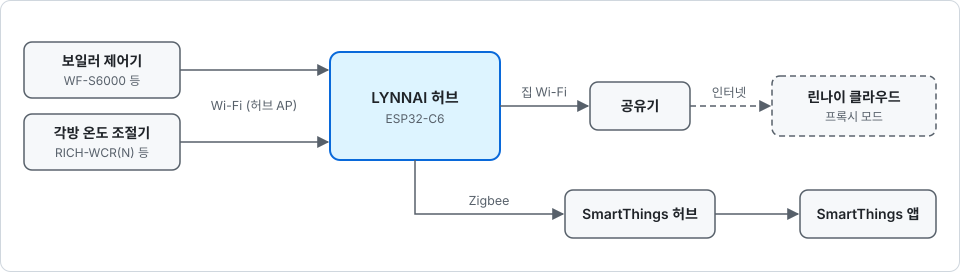

# ESP32 허브 설치·운영 안내

ESP32-C6 보드 하나로 린나이 보일러 조절기·온도 조절기를 SmartThings 에 붙이는 허브의
펌웨어 쓰기, 첫 설정, 연결, 초기화, 고장 분석 방법을 정리했습니다.



## 목차

- [1. 준비물](#1-준비물)
  - [1.1 시험한 기기](#11-시험한-기기)
- [2. 펌웨어 쓰기](#2-펌웨어-쓰기)
  - [2.1 USB 연결](#21-usb-연결)
  - [2.2 esptool 로 쓰기 (Windows · macOS · Linux)](#22-esptool-로-쓰기-windows--macos--linux)
  - [2.3 브라우저로 쓰기 (설치 없이)](#23-브라우저로-쓰기-설치-없이)
- [3. 첫 설정](#3-첫-설정)
- [4. 연결](#4-연결)
  - [4.1 허브 버튼](#41-허브-버튼)
  - [4.2 SmartThings (Zigbee)](#42-smartthings-zigbee)
  - [4.3 린나이 기기 (Wi-Fi 페어링)](#43-린나이-기기-wi-fi-페어링)
  - [4.4 관리 화면](#44-관리-화면)
  - [4.5 LAN 드라이버 (선택)](#45-lan-드라이버-선택)
  - [4.6 단독 모드](#46-단독-모드)
- [5. 초기화](#5-초기화)
- [6. 고장 분석](#6-고장-분석)
  - [6.1 LED 오류 코드](#61-led-오류-코드)
  - [6.2 USB 시리얼 진단](#62-usb-시리얼-진단)
  - [6.3 네트워크 진단](#63-네트워크-진단)
  - [6.4 자주 겪은 문제](#64-자주-겪은-문제)
- [7. 보안 메모](#7-보안-메모)
- [8. Edge 드라이버 배포 (개발자)](#8-edge-드라이버-배포-개발자)
- [부록 A. 펌웨어 직접 빌드하기](#부록-a-펌웨어-직접-빌드하기)
  - [A.1 Linux · macOS · WSL](#a1-linux--macos--wsl)
  - [A.2 Windows](#a2-windows)
  - [A.3 릴리즈 이미지 만들기](#a3-릴리즈-이미지-만들기)

---
## 1. 준비물

| 항목 | 내용 |
|---|---|
| 보드 | ESP32-C6-DevKitC-1 (플래시 8MB). **J5 점퍼가 꽂혀 있어야** 칩에 전원이 들어갑니다 |
| USB | 보드의 **UART 포트**(CP210x)에 연결합니다. 펌웨어 쓰기·로그·진단 모두 이 포트를 씁니다 |
| PC | 펌웨어 쓰기: `esptool`(Python) 또는 Chrome/Edge 브라우저. 직접 빌드는 [부록 A](#부록-a-펌웨어-직접-빌드하기) |
| SmartThings | Zigbee 를 받는 허브(스마트 홈 허브 또는 Station), LYNNAI Edge 드라이버 |
| 선택: 센서 | 온습도계(관리 화면에서 종류 선택) = SDA GPIO6, SCL GPIO7 — SHT31(0x44) · BME280(0x76/0x77) · MPL3115A2(0x60, 온도만). 셋을 같은 선에 나란히 이어도 됨 · 가스 계량기 리드 스위치 = GPIO10 ↔ GND |


### 1.1 시험한 기기

아래 조합으로만 시험했습니다. 다른 린나이 모델도 같은 프로토콜(`f06`/`f09`, J07)을 쓰면 동작할 수 있지만 확인하지 않았습니다.

| 구분 | 모델 | 허브에서의 이름 |
|---|---|---|
| 보일러 제어기 | 린나이 **WF-S6000** | 보일러 조절기 (`f06`) |
| 온도 제어기 | 린나이 **RICH-WCR(N)** (각방 제어, 방1·방2·거실 사용) | 온도 조절기 (`f09`) |
| 허브 보드 | Espressif ESP32-C6-DevKitC-1 v1.2 (플래시 8MB) | — |
| SmartThings | SmartThings Station, 스마트 홈 허브(V4) | Zigbee 를 받는 허브 |
| 센서(선택) | 온습도 센서(SHT31 · BME280 · MPL3115A2 중 하나), 가스 계량기 리드 스위치 | 플러그인 |

펌웨어·드라이버는 ESP-IDF v5.5.6, SmartThings Edge 드라이버로 시험했습니다.

---

## 2. 펌웨어 쓰기

빌드된 이미지를 GitHub **Releases** 에서 받아 씁니다. 이미지는 두 가지입니다.

| 파일 | 쓰는 주소 | 언제 |
|---|---|---|
| `lynnai-hub-esp32c6-<버전>-full.bin` | `0x0` | **처음 설치**. 부트로더·파티션 표·앱이 다 들어 있음. 허브 설정(Wi-Fi·관리자 암호 등)이 지워짐 |
| `lynnai-hub-esp32c6-<버전>-app.bin` | `0x20000` | **업데이트**. 앱만 바꿈. 설정·Zigbee 가입·허브 인증서 유지 |

업데이트는 USB 없이도 됩니다. 관리 화면의 **시스템 · 펌웨어(OTA)** 에서 `-app.bin` 을 올리면 허브가 새 펌웨어로
재시작합니다. 새 펌웨어가 집 Wi-Fi 에 붙지 못하면 허브가 스스로 이전 펌웨어로 돌아갑니다.

### 2.1 USB 연결

- 보드의 **UART 포트**를 PC 에 연결합니다.
- 포트 이름: Linux `/dev/ttyUSB0`, macOS `/dev/cu.usbserial-*`, Windows `COM3` 등
  (Windows 는 **장치 관리자 → 포트(COM & LPT)** 의 *Silicon Labs CP210x USB to UART Bridge (COMx)*.
  안 보이면 Silicon Labs 의 CP210x VCP 드라이버를 설치).
- **WSL**: Windows 에서 `usbipd list` 로 CP210x 의 BUSID 를 찾고 `usbipd attach --wsl --busid <BUSID>`.
  보드를 다시 꽂을 때마다 다시 붙여야 합니다.

### 2.2 esptool 로 쓰기 (Windows · macOS · Linux)

```sh
pip install esptool                                   # 한 번
python -m esptool --chip esp32c6 -p COM3 write_flash 0x0 lynnai-hub-esp32c6-<버전>-full.bin       # 처음 설치
python -m esptool --chip esp32c6 -p COM3 erase_region 0xf000 0x2000                               # 업데이트 ①
python -m esptool --chip esp32c6 -p COM3 write_flash 0x20000 lynnai-hub-esp32c6-<버전>-app.bin    # 업데이트 ②
```

업데이트 ①은 부팅 칸 기록을 지워 첫째 칸(`0x20000`)으로 부팅하게 합니다. 허브에는 앱 칸이 둘 있고 OTA 는 두 칸을
번갈아 쓰므로, OTA 를 한 적이 있는 허브는 ①을 빼면 방금 쓴 펌웨어가 아니라 옛 펌웨어로 켜질 수 있습니다.
파티션 표가 지금과 다른 옛 펌웨어에서 올리는 허브는 파티션 표(`0x8000`, `-partitions.bin`)도 한 번 같이 씁니다
(설정과 Zigbee 가입 정보는 유지됩니다).

포트(`COM3`)는 2.1 에서 찾은 이름으로 바꿉니다. 쓰기가 끝나면 `Hash of data verified.`(검증 통과) 뒤에
`Leaving... Hard resetting via RTS pin...` 이 나옵니다. **이 `Hard resetting...` 줄이 완료 신호**입니다 —
esptool 은 여기서 할 일을 마치고 빠져나오며 **부팅 로그는 보여주지 않으니**, 그 뒤로 화면이 조용해도 정상입니다.
보드는 저절로 다시 켜집니다.

### 2.3 브라우저로 쓰기 (설치 없이)

1. Chrome 또는 Edge 에서 Espressif 의 웹 플래셔(<https://espressif.github.io/esptool-js/>)를 엽니다.
2. **Connect** → 보드 포트를 고릅니다.
3. Flash Address 에 `0x0`(처음 설치) 또는 `0x20000`(업데이트)을 넣고 해당 파일을 고른 뒤 **Program**.
   OTA 를 한 적이 있는 허브의 업데이트는 관리 화면이나 2.2 의 방법으로 합니다(부팅 칸 때문).
4. 로그에 `Wrote … bytes` → `Hash of data verified.`(또는 `Hard resetting...`)가 나오면 **완료**입니다.
   그 뒤 보드의 RESET 버튼을 누르거나 USB 를 뺐다 꽂습니다.
   (쓰다가 `Serial data stream stopped: Possible serial noise or corruption` 로 끊기면 이미지 문제가 아니라
   링크 끊김입니다 — **페이지 새로고침**으로 포트를 놓아준 뒤 Connect 부터 다시 하거나, Baudrate 를 `115200` 으로
   낮춰 재시도합니다. 포트는 한 번에 한 곳만 열 수 있으니 다른 탭·시리얼 모니터·CLI 는 닫습니다.)

처음 설치한 허브는 첫 부팅 때 기기 접속용 인증서를 만듭니다(몇 초). 그 뒤 [3장](#3-첫-설정)으로 갑니다.

---

## 3. 첫 설정

1. 전원을 넣으면 허브가 개방형 AP **`LYNNAI-SETUP-<기기ID>`** 를 띄웁니다.
2. 휴대폰으로 그 AP 에 붙으면 설정 페이지가 자동으로 열립니다. 안 열리면 브라우저에서 `http://198.18.0.1/`.
3. 입력: 집 Wi-Fi 이름·암호, 허브 AP 이름·암호(기기 등록용, 8자 이상), 관리자 암호(8자 이상).
4. 저장하면 허브가 집 Wi-Fi 에 붙고 WPA2 AP **`LYNNAI-HUB-<기기ID>`** 를 띄웁니다.
5. 공유기에서 허브(MAC 은 USB 진단 `diag` 에 나옴)에 **고정 IP 를 할당**해 두면 관리 화면 주소가 바뀌지 않습니다.

---

## 4. 연결

### 4.1 허브 버튼

보드의 BOOT 버튼을 씁니다.

| 누르기 | 동작 |
|---|---|
| **짧게** (3초 미만) | 스마트홈 허브와 붙기: (Zigbee 를 쓰고 미가입이면) Zigbee 가입 시도(3분), (LAN 을 쓰면) LAN 드라이버 페어링 창 3분 — 가입 시도 중엔 Wi-Fi 가 멈추므로 페어링 창은 가입이 끝난 뒤 열림 |
| **길게** (3초 이상) | 새 기기 Wi-Fi 페어링: 설정 모드인 기기의 `Rinnai_…` Wi-Fi 를 찾아 허브 AP 에 등록([4.3](#43-린나이-기기-wi-fi-페어링)) |

### 4.2 SmartThings (Zigbee)

1. LYNNAI Edge 드라이버를 SmartThings 허브에 설치합니다. 초대 링크
   <https://bestow-regional.api.smartthings.com/invite/Qrjp9gnaJbMq> 를 열어 SmartThings 계정으로 로그인 →
   **등록(Enroll)** → **사용 가능한 드라이버**에서 *LYNNAI Hub (Zigbee)* 를 허브에 **설치**합니다
   (LAN 통로를 쓸 때만 *LYNNAI Hub (LAN)* 도). 개발자는 [8장](#8-edge-드라이버-배포-개발자)처럼 CLI 로 설치해도 됩니다.
2. SmartThings 앱 → **기기 추가 → 주변 기기 검색**을 켭니다.
3. 허브 버튼을 **짧게** 누릅니다. 관리 화면 **연결 방식**의 *Zigbee 가입 시도* 버튼도 같습니다(API 토큰을 쓰면 `POST /api/zigbee/join` + `Authorization: Bearer <토큰>`).
4. 앱에 **LYNNAI Hub** 가 나타납니다. 보일러·방·센서 기기는 해당 기기가 처음 상태를 보내면 자동으로 생깁니다.
   방 기기에는 켜기·설정 온도(5~40°C)와 함께 **시간**, **외출**, **예약** 스위치가 있습니다. **시간**은 조절기의 시간 모드
   (1시간에 정한 분만큼 난방)입니다. 분은 시간 스위치 아래 **1시간에** 목록에서 5·10·20·30·40·50·60분 중에 고릅니다(린나이 앱과
   같은 값). 시간 모드로 난방 중이면 바로 바뀌고, 아니면 기억만 해 두었다가 시간을 켤 때 보냅니다. 요약 글에 "시간 난방 10분"처럼
   나옵니다. 난방과 시간은 둘 중 하나만 켜짐으로 보입니다: 시간을 켜면 난방이
   꺼짐으로, 난방을 켜면 시간이 꺼짐으로(온도 모드로 돌아감). 시간을 끄면 방이 꺼집니다. 예약 중에 **예약 시간**(1~24시간)을
   바꾸면 그 시간으로 다시 걸립니다. 예약이 꺼져 있을 때 바꾼 시간은 기억만 해 두었다가 예약을 켤 때 씁니다(잘못 건드려
   방이 켜지지 않게). 예약을 걸면 꺼진 방도 기기가 켜짐으로 바꿉니다. 요약 글에 "예약 2시간"처럼 나옵니다.
   이름은 SmartThings 앱에서 바꿉니다.
   보일러 기기는 각방 온도 조절기가 붙어 있으면 **난방수 모드**로 보입니다: 방 온도는 방마다 조절기가 맡고 보일러는
   난방수만 데우므로 온도조절 모드(온돌/실내)가 없고, 난방 온도가 **난방수 온도 설정**으로 나옵니다. 조절기가 없는
   보일러는 보일러 조절기가 방 온도 조절기 노릇을 하므로 **온도조절 모드**와 **난방 온도 설정**이 나옵니다. 어느 쪽인지는
   초기 설정에서 고른 **보일러 모드**(관리 화면 **연결된 기기**의 보일러 조절기 줄 아래에서 바꿈)를 따릅니다 — 보일러 Wi-Fi 만 달린 집은 유선 조절기가
   있는지 허브가 알 수 없기 때문입니다. 보일러가 실내 모드로 동작 중이라고 알려 오면 설정과 상관없이 온돌·실내로 보입니다.
   보일러 모드를 정하지 않은 허브(이전 판에서 올린 것)는 허브가 아는 조절기(관리 화면 **연결된 기기**의 보일러 연결,
   없으면 하나뿐인 보일러)로 짐작합니다.
   온수 예열 구역의 **자동 끄기**(1~60분 / 무제한): 예열이 꺼져 있을 때 고르면 다음에 켜질 때의 기본값, 켜져 있을 때 고르면 이번 예열을 지금부터 그만큼 켜 둡니다. 켜져 있는 동안은 꺼지기까지 남은 분이 1분마다 줄어 보입니다. 허브 설정이라 어느 보일러에서 바꿔도 같습니다.

가입하는 동안 허브는 잠깐 Wi-Fi 를 멈춥니다(2.4GHz 라디오를 Zigbee 와 나눠 쓰므로). 끝나면 다시 붙습니다.

### 4.3 린나이 기기 (Wi-Fi 페어링)

린나이 기기를 허브에 붙이는 방법은 둘입니다. 어느 쪽이든 허브는 **등록된 기기만** 읽고 SmartThings 에 내보냅니다.

#### 방법 A — 허브 버튼으로 등록

1. 보일러 조절기(또는 온도 조절기)의 Wi-Fi 모듈을 **Wi-Fi 설정 모드**로 둡니다(모듈의 리셋 버튼).
   이때 기기가 이름이 `Rinnai_…` 로 시작하는 설정용 Wi-Fi 를 띄웁니다.
2. 허브 버튼을 **길게(3초)** 누릅니다. 허브가 약 20초 동안 기기를 찾으므로 1과 2의 순서는 바뀌어도 됩니다.
   허브는 **`Rinnai_…` 로 시작하는 Wi-Fi 만** 찾아, 거기에 붙어 허브 AP 의 이름·암호를 넣어 줍니다.
   다른 이름의 Wi-Fi 나 이미 다른 공유기에 붙어 있는 기기는 건드리지 않습니다.
3. LED: 파랑 = 기기 찾는 중, 노랑 = 허브 AP 정보 전송 중, 초록 = 성공, 빨강 = 실패.
4. 성공하면 기기가 허브 AP 에 붙고, **자동으로 등록**되어 관리 화면의 **연결된 기기**에 나타납니다
   (등록 성공 뒤 3분 동안 허브 AP 에 새로 붙는 기기는 자동 등록).

한 번에 한 대씩 등록합니다. 설정 모드인 기기가 여럿이면 먼저 찾은 한 대만 등록하므로, 한 대씩 설정 모드로 두고 반복하세요.

#### 방법 B — 린나이 스마트링크 앱으로 등록

허브 설정을 마친 뒤, 린나이 스마트링크 앱의 기기 등록에서 **Wi-Fi 로 허브 AP(이름·암호)를 고릅니다**
(집 공유기 대신 허브 AP).

1. 앱의 안내대로 기기를 등록합니다. 기기가 허브 AP 에 붙고, 허브가 린나이 클라우드로 이어 주므로
   **린나이 앱에도 평소처럼 등록됩니다**. 허브가 **프록시 모드**(기본)여야 합니다 — 단독 모드에서는 클라우드에
   붙지 않아 앱 등록이 끝나지 않습니다.
2. 허브에는 아직 등록되지 않은 상태입니다. 관리 화면에 **등록 대기**가 생기고 그 기기의 MAC·주소가 나옵니다
   (린나이 Wi-Fi 모듈이면 "린나이 Wi-Fi 모듈로 보임"이라고 표시).
3. 내 기기가 맞으면 **등록**을 누릅니다. 기기들의 연결이 한 번 끊겼다 수십 초 안에 다시 붙고,
   **연결된 기기**와 SmartThings 에 나타납니다.

등록하기 전에도 린나이 앱은 그대로 됩니다. 허브가 그 기기의 상태를 읽지 않고, SmartThings 에 보이지 않고,
명령을 보내지 않을 뿐입니다.

#### 등록에 대해 알아 둘 것

- **등록 대기**에는 허브 AP 에 붙어 있지만 등록 안 된 단말이 모두 나옵니다. 허브 AP 암호를 아는 다른 단말(휴대폰 등)도
  붙으면 여기에 보이므로, 내 린나이 기기가 맞을 때만 등록하세요.
- **연결된 기기**에서 기기를 삭제하면 등록도 풀립니다. 그 기기가 허브 AP 에 계속 붙어 있으면 다시 **등록 대기**에 나옵니다.
- 이 기능이 없던 펌웨어에서 올린 뒤 첫 부팅에는 10분 동안 붙는 기기를 그대로 등록합니다(쓰던 기기는 따로 할 일 없음).
  그때 꺼져 있던 기기는 나중에 **등록 대기**에 나옵니다.
- 관리 화면에 들어갈 수 없으면 USB 시리얼의 `devs`(목록), `devs add <MAC 12자리>`(등록)로도 됩니다([6.2](#62-usb-시리얼-진단)).

### 4.4 관리 화면

`http://<허브IP>/admin` (관리자 암호, 30분 세션)

| 구역 | 내용 |
|---|---|
| 동작 모드 | **프록시**(린나이 클라우드로 중계, 린나이 앱 그대로) / **단독**(클라우드 없이 허브가 직접, 린나이 앱은 안 됨). 바꾸면 기기가 다시 접속할 때 적용([4.6](#46-단독-모드)). 프록시 아래의 **린나이 서버에 닿지 않으면 자동으로 단독 동작**(기본 켬)은 서버가 끊긴 동안만 단독처럼 동작하게 합니다. 스마트홈의 허브 기기에서도 모드를 바꿀 수 있습니다 |
| 연결 방식 | Zigbee / LAN 중 사용할 통로(기본 Zigbee 만). 바꾸면 허브가 재시작해 적용. *Zigbee 가입 시도* 버튼 |
| 연결된 기기 | 기기 목록·연결 상태, ✏️ 이름(비우고 저장하면 기기 삭제), 온도 조절기의 보일러 연결, 기기·방별 노출. 보일러 조절기 줄 아래에 **보일러 모드**: 난방수(방마다 온도 조절기가 있음) / 온돌·실내(보일러 조절기 하나로 난방) — 초기 설정에서 고르고 여기서 바꿉니다. 스마트홈 화면에서 온도조절 모드를 보일지, 온도 설정을 "난방수 온도"로 부를지가 여기에 따릅니다 |
| 보일러 명령 | **명령 확인** 누계 — 허브는 보낸 명령이 2.5초 안에 기기 상태에 나타나지 않으면 같은 명령을 다시 보냅니다(모두 3번). 온수 예열 **자동 끄기**(1~60분 / 무제한)는 SmartThings·Home Assistant 의 보일러 기기(온수 예열 → 자동 끄기)에서 정합니다 |
| 등록 대기 | 허브 AP 에 붙어 있지만 등록 안 된 단말(있을 때만 보임). **등록**을 눌러야 기기로 받는다([4.3](#43-린나이-기기-wi-fi-페어링)) |
| 노출 설정 | 기기 종류별로 SmartThings 에 보일 컨트롤. **LYNNAI 허브 → 허브 내부 온도**를 끄면 허브 기기의 칩 온도(방 온도와 다름)가 사라짐. **센서 (플러그인)** 묶음에서 온습도계·가스 계량기 기기를 플랫폼에 보일지 고릅니다(설치된 센서만 나옴) |
| 서버 연동 | API 토큰(`/api/v1/state`, `/metrics` 를 쓰는 기록기용) |
| 플러그인 | 온습도계·가스 계량기 켜기, 핀, 계량기 숫자 맞추기, ⏸ 멈춤, 🗑️ 삭제(플랫폼에 보일지는 '노출 설정'에서). 카드마다 **지금 상태**(정상·마지막 값 / 오프라인·이유)가 나옵니다. 온습도계는 **센서 목록**(SHT31 · BME280 · MPL3115A2)에서 종류를 고르면 어느 핀을 어디에 이을지 표로 나오고, 선에 물려 응답하는 센서도 보여 줍니다. **⏸ 멈춤**은 센서·배선을 바꿀 때 씁니다 — 그 센서만 읽지 않고, SmartThings 의 기기는 지워지지 않은 채 오프라인으로 보입니다(▶ 로 다시 시작) |
| 저장 데이터 암호화 | eFuse 키 블록(KEY0~KEY5) 상태와 암호화 켜기 — 누른 뒤 60초 안에 허브 버튼 확인([7장](#7-보안-메모)) |

**센서 고장 표시**: 허브가 센서를 고장으로 보면 관리 화면의 플러그인 카드에 이유가 나옵니다. 온습도계는 SmartThings 에서
오프라인이 되고, 가스 계량기는 기기는 그대로 두고 **"펄스 없음" 경고**를 냅니다. 다시 정상이 되면 저절로 풀립니다.

| 센서 | 고장으로 보는 때 | 풀리는 때 |
|---|---|---|
| 온습도계 | 읽기가 3번 연속 실패(약 40초) → 오프라인 | 다시 읽히면 곧바로(고장 중엔 30초마다 다시 읽어 봄) |
| 가스 계량기 | 보일러가 **연소한** 시간이 10분 쌓이도록 펄스가 하나도 없음(1펄스가 10 L 일 때. 1펄스 양 × 60초, 최소 10분) → 경고 | 펄스가 하나 들어오면 |

'연소' 는 보일러 조절기 상태의 연소 표시입니다(난방·온수 둘 다 — 온수만 쓸 때도 감시합니다). 실측(난방만)으로는 연소가
시작되고 20~32초 안에 첫 펄스가 오고, 펄스 사이에 쌓이는 연소 시간은 보통 67~69초, 가장 길게 85초였습니다. 온수만 쓸
때의 약한 불은 아직 재 보지 못해 한도를 넉넉히 10분으로 두었습니다. 허브는 펄스마다 '직전 펄스 뒤 연소한 시간'을 난방만 /
온수가 낀 경우로 나눠 세어 두므로(`/api/v1/state` 의 `gas.burn_per_pulse`, 재부팅해도 남음) 그 분포를 보고 한도를
줄입니다. 보일러 조절기가 연결돼 있지 않으면 예전처럼 온도
조절기의 '난방 중' 시간으로 봅니다(30분, 1펄스 양 × 180초).

경고가 뜨면 SmartThings 가스 계량기 기기의 **계량기 신호** 가 "펄스 없음" 이 되고 목록의 요약 글자 앞에 "⚠ 계량기 펄스
없음" 이 붙습니다. 드라이버는 휴대폰 알림을 직접 보내지 못하므로 **루틴**을 하나 만들어 두세요: 조건 = 가스 계량기의
계량기 신호가 "펄스 없음", 동작 = 알림 보내기. Home Assistant 에서는 가스 계량기의 `계량기 펄스 없음`(problem) 센서가
켜집니다. 관리 화면의 가스 카드는 지금 스위치가 계속 닫혀 있으면(자석이 스위치 앞에 머물렀거나 선이 붙음) 그것도 알려
줍니다.

USB 진단 `diag` 의 `sensor` 줄, `/api/v1/state` 의 `hub.sensor_faults`(1 = 온습도계, 2 = 가스)와 `gas.no_pulse`·
`gas.burn_s`(마지막 펄스 뒤로 연소한 초), `/metrics` 의 `lynnai_sensor_fault`·`lynnai_gas_burn_no_pulse_seconds`,
이벤트 `gas_no_pulse`(시작·풀림) 로도 볼 수 있습니다. v0.7 까지의 드라이버는 이 경고를 오프라인으로 보입니다.

### 4.5 LAN 드라이버 (선택)

LAN 통로(TCP 8484)는 기본으로 꺼져 있습니다. 관리 화면 **연결 방식**에서 LAN 을 켜면 허브가 재시작하며 열고,
LAN Edge 드라이버를 설치합니다. 새 드라이버는 **첫 설치도** 허브 버튼을 **짧게** 눌러 연 3분 페어링 창 안에서만
등록됩니다(집 LAN 의 아무 기기나 먼저 붙어 등록되지 않게). 이미 페어링된 드라이버는 다시 누를 필요가 없습니다.
드라이버는 허브가 답한 id 가 찾은 허브와 같을 때만 붙습니다. 연결 방식에서 끈 통로로 온 명령은 따르지 않습니다.

> LAN 통로는 **믿을 수 있는 집 네트워크에서만** 쓰세요. 드라이버의 토큰과 명령이 암호화 없이 TCP 로 오가고, 드라이버는
> 상대가 진짜 허브인지 확인하기 전에 토큰을 보냅니다. 같은 LAN 에서 허브 행세를 하는 기기는 토큰을 받아 보일러를
> 제어할 수 있습니다. 그런 걱정이 있으면 Zigbee 통로만 쓰세요(기본값).

### 4.6 단독 모드

관리 화면의 **동작 모드 → 단독**(또는 USB 시리얼 `mode standalone`)으로 바꾸면 허브가 린나이 클라우드에 붙지 않고
기기의 MQTT 상대가 됩니다. 인터넷이 끊겨도 SmartThings 로 상태를 보고 제어할 수 있지만 린나이 앱에서는 기기가
오프라인으로 보입니다. 클라우드가 하던 일은 허브가 대신합니다.

- 기기가 접속해 구독하면 곧바로, 그 뒤 30초마다 상태를 요청합니다.
- 기기가 약 1시간마다 묻는 현재 시각에 한국 시각으로 답합니다(예약 기능용). 허브 시계가 아직 안 맞았으면(인터넷이
  한 번도 안 된 경우) 답하지 않습니다.
- 기기가 접속 정보(`/key/server`)를 물으면 허브가 만든 답(허브용 임시 계정)을 줍니다. 프록시 때 받아 둔 린나이
  계정은 단독 모드에서 내주지 않습니다. 그래서 단독 → 프록시로 되돌리면 기기가 접속 정보를 다시 받을 때까지
  (1분 안팎) 클라우드가 접속을 거절합니다.

프록시로 등록해 쓰던 기기는 그대로 단독으로 옮겨 붙습니다. 되돌릴 때는 **프록시**를 고르면 됩니다.

**스마트홈에서 바꾸기**: SmartThings 의 허브 기기(LYNNAI Hub)에 "모드" 칸이, Home Assistant 의 허브 기기에 "동작 모드"
선택이 있습니다(프록시 / 단독). 고르면 관리 화면에서 바꾼 것과 같습니다. 이 선택은 **설정**이라 아래의 자동 단독 동작으로
실제 동작이 바뀌어도 그대로입니다. 지금 실제로 어떻게 동작하는지는 "상태"가 보여 줍니다: `프록시 모드`, `단독 모드`, 또는
자동 단독 동작 중일 때 `단독 모드 (18:25부터 린나이 서버 연결 안 됨)`처럼 언제부터·왜인지까지. SmartThings 기기 목록에는 이때 짧게
`임시 단독 모드`라고 나오고, 관리 화면의 동작 모드 카드에도 같은 "현재 상태"가 있습니다(자동 단독 동작 중이면 빨간 글씨).

**린나이 서버에 닿지 않을 때 (자동 단독 동작)**: 프록시 모드에서 린나이 서버 쪽이 두 번 연달아 실패하면(보통 1분 안)
허브가 그동안만 단독 모드처럼 기기를 직접 받습니다. "성공"의 기준은 **서버가 기기의 로그인을 받아 준 것**입니다 — 연결이
안 될 때뿐 아니라, 연결은 되는데 로그인을 거절하거나 답이 없거나 바로 끊는 서버도 닿지 않는 것으로 셉니다. 스마트홈
제어는 계속되고 린나이 앱에서는 기기가 오프라인으로 보입니다. 허브는 1분마다 서버에 보안 연결까지 해 보고, 두 번 연달아
되면 기기를 다시 붙게 해서 프록시로 돌아갑니다(돌아갔다가 또 실패하면 확인 간격을 10분까지 늘립니다).

상태 글에는 까닭이 구체적으로 나옵니다.

| 상태 글의 까닭 | 뜻 |
|---|---|
| 집 Wi-Fi 끊김 | 허브가 집 Wi-Fi 에 붙어 있지 않음 |
| 린나이 서버 주소 조회 실패 | 서버 이름(`www.rkiot.net`)의 주소를 DNS 가 알려 주지 않음 |
| 린나이 서버 연결 안 됨 | 서버에 연결 자체가 안 됨(인터넷 끊김, 서버 죽음, 공유기에서 막힘) |
| 린나이 서버 보안 연결 실패 | 연결은 되는데 암호화·인증서 단계에서 실패 |
| 린나이 서버 로그인 거절(코드 N) | 서버가 기기의 로그인을 거절(MQTT 거절 코드. 4 = 아이디·암호 틀림, 5 = 권한 없음) |
| 린나이 서버 로그인 응답 없음 | 로그인을 보냈는데 15초 안에 답이 없음 |
| 린나이 서버가 연결을 끊음 | 로그인을 받아 주기 전에 서버가 끊음 |

서버 주소는 DNS 답만 따릅니다. 답에 든 주소들을 그 TTL 동안만 쓰고(30초~1시간 사이), 지나면 다시 묻습니다. 주소가
여럿이면 차례로 시도하고, 안 되는 주소는 뒤로 돌립니다. 저장해 둔 주소는 없어서 DNS 가 답하지 않으면 서버에 닿지 않는
것으로 봅니다.

기기 하나만 로그인이 안 되고 다른 기기는 서버에 붙어 있으면(예: 린나이 계정에서 그 기기만 지운 경우) 서버는 멀쩡한
것이므로 자동 단독 동작으로 넘어가지 않습니다. 이때는 프록시 때 받아 둔 접속 정보를
그대로 쓰므로 돌아갈 때 거절되는 시간이 없습니다. 이때도 "모드"는 정해 둔 대로 프록시이고, 지금 이 상태인지와 언제부터인지는
관리 화면의 동작 모드 카드와 스마트홈 허브 기기의 "상태"에 표시됩니다. 원치 않으면 동작 모드 카드에서 끕니다(끄면 서버가 돌아올 때까지 기기가 붙지 못해 스마트홈에서도 제어되지
않습니다).

---

## 5. 초기화

USB 를 연결하고 `esptool`([2.2](#22-esptool-로-쓰기-windows--macos--linux))로 실행합니다. 주소는 `partitions.csv` 기준입니다.

| 무엇을 | 명령 | 결과 |
|---|---|---|
| **설정만** | `python -m esptool --chip esp32c6 -p <포트> erase_region 0x9000 0x6000` | Wi-Fi·관리자 암호·플러그인·노출·이름·동작 모드·허브 인증서가 지워지고 첫 설정 AP 로 돌아감. 기기 ID 도 새로 뽑힘. **Zigbee 가입은 유지** |
| **Zigbee 가입만** | `python -m esptool --chip esp32c6 -p <포트> erase_region 0x625000 0x10000` | 허브가 Zigbee 초기 상태가 됨. SmartThings 에서 옛 LYNNAI Hub 를 지우고 [4.2](#42-smartthings-zigbee)대로 다시 추가 |
| **전부** | `python -m esptool --chip esp32c6 -p <포트> erase_flash` 후 처음 설치 이미지 쓰기([2장](#2-펌웨어-쓰기)) | 공장 출하 상태. 새 기기 ID 가 뽑힘 |

지운 뒤 보드를 다시 켜면 적용됩니다. 기기 ID 가 바뀌면 허브 AP 의 기본 이름(`LYNNAI-HUB-<기기ID>`)도 바뀝니다.
첫 설정에서 **예전과 같은 허브 AP 이름·암호**를 넣으면 린나이 기기가 그대로 다시 붙고,
다르게 넣으면 [4.3](#43-린나이-기기-wi-fi-페어링)대로 기기를 다시 등록합니다.

---

## 6. 고장 분석

### 6.1 LED 오류 코드

빨강이 **N번 깜빡**인 뒤 2초 쉽니다. 여러 개면 돌아가며 보여 줍니다.

| 깜빡임 | 뜻 | 먼저 볼 것 |
|---|---|---|
| 1 | 집 Wi-Fi 2분 넘게 끊김 | 공유기 전원, Wi-Fi 이름·암호 변경 여부, 허브 위치(신호 약함) |
| 2 | Zigbee 미가입(부팅 90초 뒤에도) | SmartThings 에서 기기 추가 켜고 버튼 짧게 |
| 3 | 린나이 기기 링크 5분 넘게 끊김 | 기기 전원, 기기가 허브 AP 에 붙었는지(`diag` 의 `ap_clients`), 필요하면 버튼 길게로 다시 등록 |
| 4 | 저장 데이터 오류(재부팅 전까지 유지) | 관리 화면 맨 위 경고에 나온 설정을 다시 저장한 뒤 재부팅 |

진행 표시(파랑·노랑)가 켜져 있는 동안에는 오류 코드 대신 진행 색이 보입니다.

### 6.2 USB 시리얼 진단

네트워크로 허브에 닿지 않을 때 쓰는 방법입니다. UART 포트에 연결하고 115200bps 로 `diag` 한 줄을 보냅니다.

```sh
python3 tools/hub_doctor.py --serial /dev/ttyUSB0      # diag 를 받아 해석하고 파일로 저장
```

`#DIAG-BEGIN … #DIAG-END` 에 펌웨어 버전, 재시작 사유, 메모리, LED 코드, 집 Wi-Fi(SSID·IP·신호),
허브 AP 에 붙은 기기, Zigbee 상태(부모 기기의 신호 `zb nbr … rssi=`), 린나이 기기 링크, 저장 오류, NVS 사용량,
최근 이벤트 40개가 나옵니다.
**비밀값(Wi-Fi·AP 암호, 관리자 암호, API 토큰, 키)은 나오지 않으므로** 결과 파일을 그대로 공유해도 됩니다.
다른 명령: `help`, `led`, `mode`(지금 동작 모드), `mode proxy` / `mode standalone`(동작 모드 바꾸기 — 관리 화면에
들어갈 수 없을 때. USB 를 꽂을 수 있으면 관리자와 같은 권한으로 본다), `scan`(허브가 듣는 Wi-Fi AP 의 채널·신호 —
무선이 약할 때 어느 AP 가 안 들리는지 본다), `devs`(등록된 기기와 허브 AP 에 붙은 단말), `devs add <MAC 12자리>`(등록),
`devs unreg <MAC 끝 6자리>`(등록만 풀기 — SmartThings 의 기기는 지우지 않는다).

허브는 같은 이름의 AP 가 여럿(메시)이면 신호가 가장 센 것에 붙습니다. 라디오가 하나라, 부팅 직후에는 Zigbee 재가입이
끝난 뒤(보통 1~2초, 길어도 13초 뒤)에 Wi-Fi(허브 AP 와 집 Wi-Fi 접속)를 켭니다. 약한 AP(-75dBm 아래)에 붙어 있으면
90초 뒤 다시 훑어, 15dB 넘게 센 같은 이름의 AP 가 있으면 그쪽으로 옮깁니다.

허브는 SmartThings 허브의 신호 품질(LQI)이 40 이상이면 부모로 받아들입니다(Zigbee 스택의 기본값은 75). 기본값 그대로면
두 허브가 방 하나쯤 떨어졌을 때 신호가 기준 근처를 오가서, 부팅 때 재가입이 연달아 실패하고 끝내 가입 정보를 잃는 일이
있었습니다. 바꾸려면 `GET /api/v1/zbscan?minlqi=<20~100>`(255 = 스택 기본값, 저장됨). 같은 주소로 지금 들리는 신호 품질의
분포도 볼 수 있습니다.

진단 주소(`/api/v1/bootlog`, `/api/v1/zbscan`)는 읽기만 할 때는 읽기 API 와 같은 인증(토큰이 없으면 LAN 에 열림)이지만,
값을 바꾸거나 라디오를 쓰는 인자(`zblvl`·`reboot`·`cloudblock`·`cmddrop`·`preoff`, `n`·`setdur`·`minlqi`·`onfail`·`auto`)가
하나라도 있으면 **원격 디버그 키**(`Authorization: Bearer <키>`) 또는 관리자 로그인만 받습니다(아니면 403).
디버그 키는 OTA(서명 검증 없음)와 재부팅까지 되므로 관리자 암호와 같은 무게로 다루세요.

그래도 Zigbee 재가입이 자주 늦거나 실패하면 주변 Wi-Fi 와의 간섭을 의심하세요. Zigbee 채널 20(2450MHz)은 Wi-Fi 채널 11 대역의
바로 아래에 맞닿아 있습니다. 허브 가까이에 채널 9~11 을 쓰는 공유기가 있으면, 공유기의 2.4GHz 채널을 1 로 옮기거나
SmartThings 허브의 Zigbee 채널을 바꾸는 것으로 나아질 수 있습니다(이 허브에서 확인한 것은 아니고 일반적인 대처입니다).

시리얼 포트를 열 때 보드가 리셋되거나 버튼이 **짧게** 눌린 것으로 처리될 수 있습니다(USB-UART 의 DTR/RTS 가
리셋·BOOT 에 연결됨). Zigbee 미가입 상태라면 이때 가입 시도가 시작되어 Wi-Fi 가 몇 분 멈출 수 있습니다.
전체 로그는 아무 시리얼 터미널(115200bps)로 보거나, 빌드 환경이 있으면 `idf.py -p <포트> monitor` 로 봅니다(보드가 리셋됨).

### 6.3 네트워크 진단

```sh
python3 tools/hub_doctor.py                    # 허브 API 로 점검(기본 192.168.0.50, --host 로 변경)
python3 tools/hub_doctor.py --token <토큰>     # 관리 화면에서 API 토큰을 켠 경우
python3 tools/hub_doctor.py --st               # SmartThings CLI 로 ST 기기 상태도 점검
```

직접 볼 수 있는 주소:

| 주소 | 내용 |
|---|---|
| `/api/stats` | 실제 Zigbee 가입 여부(`zb_joined_now`), 초기 상태 여부, 메모리, LED 코드, 저장 오류, 이벤트 횟수 |
| `/api/events?since=N` | 최근 이벤트(접속·끊김·TLS·가입 실패 등, 부팅 후 ms 기준) |
| `/api/v1/state` | 보일러·방 상태(해독값 + 원본, `model` = 기기 토픽의 모델코드 두 자리 — 온도 표를 가른다), 온습도, 가스. `cmd` = 명령 확인 누계(`resent` 답이 없어 다시 보낸 횟수, `failed` 3번 보내도 반영 안 된 명령)와 온수 예열 자동 끄기(`preheat_off_min`, 0 = 무제한). `boiler.usage` = 보일러가 1시간마다 올리는 사용량 누계(stg — `heat_gas_m3`·`hw_gas_m3`·`heat_burn_h`·`hw_burn_h`, 정수, `age_s` 받은 지 몇 초; 받기 전엔 `null`). `/metrics` 엔 `lynnai_boiler_gas_cubic_meters`·`lynnai_boiler_burn_hours`, 이벤트 `boil_stg` |

### 6.4 자주 겪은 문제

| 증상 | 원인 | 해결 |
|---|---|---|
| SmartThings 기기가 전부 오프라인, LED 2번 | 허브 Zigbee 가입 정보가 없음(부팅 로그 `factory-reset mode`) | 기기 추가 켜고 버튼 짧게. ST 의 ONLINE 표시는 늦게 바뀔 수 있음 |
| Zigbee 가입 실패가 `0x03` 으로 반복 | 열린 Zigbee 망이 없음 | SmartThings 앱에서 **기기 추가 → 주변 기기 검색**이 켜져 있는지 |
| 허브가 집 LAN 에서 사라짐, 이벤트에 `sta_down` 사유 201 | Zigbee 스캔이 라디오를 오래 잡음 | 펌웨어가 재시도 간격을 늘려 처리. 계속되면 Zigbee 를 다시 가입 |
| 가상 '보일러 1' 이 생김 | 온도 조절기가 붙을 실제 보일러를 못 찾음 | 보일러 조절기 연결 확인. 붙으면 자동으로 사라짐. 관리 화면에서 연결 지정 가능 |
| 린나이 앱이 안 됨 | 단독 모드, 또는 프록시인데 린나이 서버에 닿지 않아 단독으로 동작 중(관리 화면 동작 모드 카드에 표시) | 단독 모드면 프록시로 바꿈. 자동 단독 동작 중이면 인터넷·린나이 서버가 돌아오면 스스로 풀림 |
| 단독 모드에서 처음 등록한 기기가 프록시로 바꾼 뒤 안 붙음 | 단독 모드 등록 때 허브가 임시 접속 정보를 줌 | 버튼 길게로 그 기기를 다시 등록(프록시 모드에서) |
| 이벤트에 클라우드 TLS 실패 `-188`, 로그에 "클라우드 인증서 검증 실패" | 클라우드가 고정한 CA(ckstack)와 다른 인증서를 냄 — 가짜 서버이거나 린나이가 CA 를 바꿈 | 네트워크 경로 확인. 린나이가 바꾼 것이면 `cloud_ca.crt` 를 새 CA 로 바꾼 펌웨어로 업데이트. 그동안은 단독 모드로 |
| 부팅 직후 클라우드 TLS 실패(err -308) 몇 번 | 부팅 직후 연결이 몰림 | 곧 재접속되면 정상 |
| 저장 데이터 오류(LED 4번) | 저장 중 전원 끊김 등으로 값 손상 | 경고에 나온 설정을 다시 저장 후 재부팅. 반복되면 보드 점검 |
| LED 4번 + 허브가 아예 안 뜸(USB 에 `#복구 모드`) | 설정 저장소(`nvs`)가 가득 찼거나 다른 펌웨어 버전 형식 | 허브는 설정을 스스로 지우지 않습니다. USB 시리얼에 `reboot`(다시 시도) 또는 `nvs erase`(설정을 지우고 첫 설정부터, Zigbee 가입은 유지) |
| 메모리 최저치가 낮음(`heap_min`) | 여러 기기가 동시에 TLS 연결 | 일시적이면 무시. 재시작이 반복되면 `diag` 의 재시작 사유 확인 |
| 재시작 사유가 패닉·워치독 | 펌웨어 오류 | 시리얼 로그(또는 `idf.py monitor`)에서 Guru Meditation 백트레이스를 받아 보고 |

---

## 7. 보안 메모

- **저장 데이터 암호화(선택)**: 기본은 꺼져 있어, USB 로 플래시를 통째로 읽으면 집 Wi-Fi 암호, 허브 AP 암호,
  API 토큰, 허브 인증서 키, Zigbee 가입 정보가 평문으로 보입니다(관리자 암호는 PBKDF2 해시로만 저장).
  관리 화면 **저장 데이터 암호화**에서 eFuse 키 블록 하나를 고르고 켠 뒤, **60초 안에 허브 버튼을 짧게** 누르면
  (허브 앞에 있는 사람만 켤 수 있게):
  - 비어 있는 블록이면 무작위 키를 **굽습니다**(HMAC 상향 용도, 굽는 즉시 읽기·쓰기 금지 — USB 로도 못 꺼냄).
  - 이미 HMAC 상향 키가 있는 블록이면 굽지 않고 그 키를 씁니다.
  - 허브가 재시작하며 Wi-Fi·Zigbee 를 켜기 전에: 저장 데이터(`nvs`, `zb_nvs`)를 원본 그대로 전용 영역
    (`cryptj`)에 백업·확인 → (필요하면) 굽기 → 그 키에서 만든 XTS-AES 키로 암호화해 되쓰고 다시 읽어 하나하나 비교 →
    완료 표시(마커, `cryptj` 마지막 두 섹터에 두 벌)를 남기고 평문 백업을 지운 뒤 재시작합니다. 정상적으로 마치면 기존 설정과 Zigbee 가입이 유지됩니다.
  - 전환 도중 전원이 끊기면 다음 부팅에서 백업 복구를 시도합니다. **암호화에 실패하면 허브를 다시 설정하거나 SmartThings와 Zigbee 페어링을 다시 해야 할 수 있습니다.**
  - 부팅 때 마커가 있어야 암호화된 저장소로 엽니다. HMAC 키만 있고 마커가 없으면 평문으로 봅니다.
    다만 마커가 없는데 저장소가 평문이 아니면(열지 않고 첫 항목만 읽어 가림) 그 HMAC 키로 풀리는지 확인해, 풀리면
    마커를 남기고 암호화로 엽니다(마커를 쓰기 전의 펌웨어로 암호화한 허브). 풀리지 않으면 지우지 않고 복구 모드로 갑니다.
  - 전환 기록이나 백업을 읽지 못하거나 깨져 있으면 스스로 판단하지 않고 백업을 남긴 채 복구 모드로 갑니다
    (LED 4번, USB 에서 `reboot` 또는 `nvs erase`).
  - **eFuse 는 되돌릴 수 없고 암호화는 끌 수 없습니다.** 다른 용도로 쓰인 블록은 고를 수 없습니다.
  - 전환 기록과 마커는 파티션 표 맨 뒤의 `cryptj` 영역(128KB)에 둡니다. 이 영역이 없는 옛 파티션 표에서는 암호화를 새로
    켤 수 없습니다(이미 켠 허브는 옛 자리의 마커를 읽어 그대로 동작하고, 새 파티션 표를 쓰면 마커를 옮겨 적습니다).
  - **막는 범위**: 허브를 가져가 USB 로 플래시를 통째로 읽어 가는 것(덤프)입니다. 보안 부팅이 없고 USB 다운로드 모드가
    열려 있으므로, USB 로 자기 코드를 칩에서 실행할 수 있는 사람은 같은 칩 키로 풀 수 있습니다. 실제로 확인했습니다
    (2026-11-20): 덤프만으로는 아무것도 읽히지 않지만, 플래시를 건드리지 않고 RAM 에 올린 작은 프로그램이 칩의 HMAC 장치로
    저장소 키를 만들어 냈고, 그 키로 덤프를 PC 에서 풀 수 있었습니다(1분쯤 걸림). 이것까지 막으려면 보안 부팅과 보안
    다운로드 모드가 필요한데, eFuse 를 더 굽는 일이고 USB 로 펌웨어를 올리는 방식이 제한됩니다(이 펌웨어는 하지 않음).
  - **다운그레이드 주의**: 암호화한 허브에 이 기능이 없는 옛 펌웨어를 올리면 평문으로 열려 저장 데이터가 지워집니다.
  - USB 진단 `crypt`(또는 `diag`)로 암호화 상태와 KEY0~KEY5 사용 여부를 볼 수 있습니다.
  - 플래시 암호화·보안 부팅은 쓰지 않습니다(펌웨어 이미지에는 비밀값이 없음).
- 기기는 허브 인증서를 검증하지 않습니다(그래서 허브가 기기를 받을 수 있음).
- 허브는 린나이 클라우드 인증서를 **사설 CA "ckstack"(펌웨어의 `main/cloud_ca.crt`, 2123년까지)으로 검증**합니다.
  서명 체인에 더해 인증서 이름이 `dev2.ckpush.com`(접속 이름 `www.rkiot.net` 과 다름)인지 확인하고, TLS 1.2 이상만
  씁니다. CA 를 못 읽으면 클라우드에 붙지 않습니다. 허브 시계가 맞기 전(부팅 직후)에는 날짜 검사만 건너뜁니다.
  NAS 프록시도 같은 CA·이름으로 검증합니다(`UPSTREAM_CA`, `UPSTREAM_CN`).
- 기기 쪽(MQTT 8883, `/key/server`)은 **허브 AP 대역(198.18.0.x)에서 온 연결만** 받습니다. 집 LAN 에서 오면 거절(403).
  `/key/server` 응답은 기기별로, 정상(성공 코드) 응답만 저장하고, 단독 모드에서는 허브가 만든 임시 접속 정보만 줍니다.
- 관리자 로그인은 같은 주소에서 5번 틀리면 그 주소만 5분 동안 잠깁니다. 여러 주소를 합쳐 20번 틀리면, 이번 부팅에
  로그인한 적 없는 주소는 모두 5분 동안 잠깁니다(주소를 바꿔 가며 맞히는 것 막기). `POST /api/zigbee/join`(Wi-Fi 를 최대 3분
  멈춤)은 관리자 세션이나 API 토큰이 있어야 합니다. SmartThings 명령은 Zigbee 코디네이터(SmartThings 허브)에서 온
  것만, 그리고 확인한 쓰기 코드만 보일러에 보냅니다.
- 관리 화면·API 는 집 LAN 에서 평문 HTTP 입니다(관리자 암호·세션 쿠키·새 API 토큰이 암호화되지 않고 오감).
  믿을 수 있는 집 네트워크에서만 쓰세요.
- 클라우드 주소는 허브가 집 Wi-Fi 쪽 DNS 로 직접 조회합니다(허브 자체 DNS 는 기기를 허브로 돌리기 위해
  `rkiot.net` 을 허브로 답합니다).

---

## 8. Edge 드라이버 배포 (개발자)

```sh
smartthings edge:drivers:package edge-driver --channel <채널ID>       # 공개 채널 "LYNNAI Hub" = 9231d747-aeb6-45da-8436-22ac6161f531
smartthings edge:drivers:install <드라이버ID> --hub <허브 전체 UUID> --channel <채널ID>
smartthings edge:drivers:logcat <드라이버ID> --hub-address <허브IP>     # 드라이버 로그
cd edge-driver/test && python3 run_sim.py                                # 하드웨어 없이 드라이버 시험(lupa 필요)
```

- 허브 ID 는 전체 UUID 를 써야 합니다(앞부분만 쓰면 400 오류).
- 이미 등록된 기기는 새 드라이버 설치만으로 바뀌지 않으면 `edge:drivers:switch` 로 옮깁니다.

---

## 부록 A. 펌웨어 직접 빌드하기

릴리즈 이미지 대신 소스에서 빌드할 때만 필요합니다. 펌웨어에는 비밀값이 들어가지 않습니다(기기 접속용 인증서는
허브가 첫 부팅 때 직접 만들고, 클라우드 CA `main/cloud_ca.crt` 는 공개 정보).

### A.1 Linux · macOS · WSL

```sh
# ESP-IDF v5.5.6 설치(한 번) — https://docs.espressif.com/projects/esp-idf/en/stable/esp32c6/get-started/
. ~/esp/esp-idf/export.sh          # 터미널마다
cd firmware/esp32
./build_all.sh                      # 빌드(idf.py build 와 같음)
./build_all.sh flash /dev/ttyUSB0   # 빌드하고 굽기: 부트로더·파티션 표·앱(설정·Zigbee 가입 정보 유지)
idf.py -p /dev/ttyUSB0 monitor      # 로그(보드가 리셋됨, 끝내기 Ctrl+])
```

빌드한 `build/lynnai_hub.bin` 을 관리 화면의 **시스템 · 펌웨어(OTA)** 에 올려도 됩니다.

- 처음 빌드에서 "wolfssl 매니지드 컴포넌트가 없습니다"가 나오면 `idf.py reconfigure` 를 한 번 더 하고 빌드합니다.
  wolfSSL 설정 원본은 `firmware/esp32/wolfssl/user_settings.h` 입니다.
- `main/` 에 새 `.c` 파일을 추가하면 `idf.py reconfigure` 가 필요합니다.
- 파티션 표(`partitions.csv`)를 바꿨다면 `flash` 로 전부 다시 쓰고, 필요하면 [초기화](#5-초기화)를 함께 합니다.

### A.2 Windows

WSL 없이 Windows 에서 바로 빌드하는 방법입니다.

1. **ESP-IDF 설치**: Espressif 의 *ESP-IDF Tools Installer for Windows*(온라인 또는 오프라인)를 받아 실행하고
   버전 **v5.5.6** 을 고릅니다. Python·Git·툴체인이 같이 깔리고, 시작 메뉴에 **ESP-IDF 5.5 PowerShell** /
   **ESP-IDF 5.5 CMD** 바로가기가 생깁니다. 설치 경로와 레포 경로는 **짧고 공백·한글이 없는 곳**
   (예: `C:\esp`, `C:\work\lynnai-hub`)에 둡니다. 경로가 길거나 공백이 있으면 빌드가 실패할 수 있습니다.
   VS Code 를 쓴다면 *ESP-IDF* 확장에서 같은 버전을 설치해도 됩니다.
2. **USB 포트**: [2.1](#21-usb-연결)처럼 COM 포트를 찾습니다.
3. **빌드·쓰기**: 시작 메뉴의 **ESP-IDF 5.5 PowerShell** 을 열고(일반 PowerShell 은 `idf.py` 를 모름)

   ```powershell
   cd C:\work\lynnai-hub\firmware\esp32
   idf.py build
   idf.py -p COM3 flash          # 굽기(설정·Zigbee 가입 정보 유지)
   idf.py -p COM3 monitor        # 로그 보기(보드가 리셋됨, 끝내기 Ctrl+])
   ```

4. **진단 스크립트**: `pip install pyserial` 후 `python tools\hub_doctor.py --serial COM3`.
5. **Edge 드라이버를 Windows 에서 패키징**한다면: `edge-driver-lan/` 이 `edge-driver/` 의 파일을 심볼릭 링크로
   가리킵니다. Windows 개발자 모드를 켜고 `git config --global core.symlinks true` 를 한 뒤 클론해야 링크가
   살아 있습니다. 아니면 WSL·Linux 에서 패키징합니다.

### A.3 릴리즈 이미지 만들기

빌드한 뒤 `firmware/esp32` 에서:

```sh
./build_all.sh release <버전>
```

`-full.bin`(처음 설치용, 0x0), `-app.bin`(업데이트·OTA 용, 0x20000), `-partitions.bin`(파티션 표, 0x8000)이 만들어집니다.

버전은 `X.Y` 형식입니다. 첫 배포는 `0.0`, **패치는 0.1씩**(0.0 → 0.1 → 0.2 …), **기능 추가는 1씩**(0.x → 1.0) 올립니다.

Edge 드라이버도 같은 버전으로 냅니다. `edge-driver/config.yml` 과 `edge-driver-lan/config.yml` 의 `description` 끝에
같은 버전(예 `(v0.1)`)을 적고 공개 채널에 다시 올립니다.
