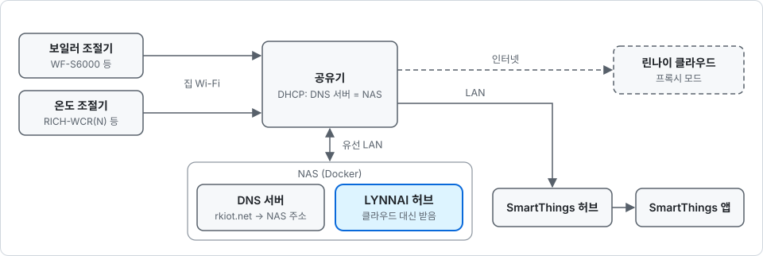

# NAS 허브 설치·운영 안내

ESP32 보드 없이 NAS(도커) 하나로 린나이 보일러 조절기·온도 조절기를 SmartThings 에 붙이는 방법입니다.
동작은 [ESP32 허브](esp32-hub.md)와 같고, 전용 Wi-Fi AP·Zigbee·꽂는 센서만 없습니다.



> ## ⚠️ 먼저 읽기: 집 네트워크의 DNS 서버를 바꿉니다
>
> NAS 허브는 린나이 기기가 클라우드 주소(`rkiot.net`)를 물을 때 NAS 주소로 답해야 동작합니다. 그러려면 **공유기의
> DHCP 가 나눠 주는 DNS 서버를 NAS 로 바꿔야 합니다.** 이 변경은 린나이 기기만이 아니라 **집 안 모든 기기**(휴대폰,
> PC, TV 등)에 적용됩니다.
>
> - 모든 기기의 DNS 질의가 NAS 를 거칩니다. NAS 는 등록된 린나이 기기의 `rkiot.net` 질의만 바꿔 답하고, 나머지는
>   전부 공유기로 그대로 넘깁니다.
> - NAS 나 컨테이너가 꺼지면 집 전체의 이름 풀이가 느려지거나 안 될 수 있습니다. 2차 DNS 로 공유기를 적어 두면
>   대부분 이어지지만, 기기에 따라 몇 초씩 기다리기도 합니다.
> - 2차 DNS 를 적어 두면, 린나이 기기가 가끔 2차(공유기)에 물어 NAS 를 거치지 않고 린나이 클라우드로 바로 갈 수
>   있습니다. 그동안은 허브가 그 기기를 못 봅니다.
> - 되돌리려면 공유기의 DNS 설정을 원래대로 돌리고 기기들이 주소를 다시 받게 하면 됩니다([8장](#8-되돌리기)).
>
> 집 네트워크의 DNS 를 건드리고 싶지 않다면 **[ESP32 허브](esp32-hub.md)를 쓰세요.** ESP32 허브는 린나이 기기를
> 자기 전용 Wi-Fi AP 로 받으므로, DNS 를 바꿔 답하는 범위가 그 AP 안으로 한정됩니다.
>
> 공유기가 **기기별 DNS 지정**(DHCP 예약에 DNS 를 따로 주는 기능)을 지원하면, 린나이 기기에만 NAS 를 DNS 로 주는
> 방법도 있습니다. 그러면 다른 기기는 영향을 받지 않습니다. 이 방법은 공유기마다 달라 여기서 확인하지는 않았습니다.

```
린나이 기기 ──DNS "rkiot.net?"──▶ NAS(:53)    등록된 기기면 NAS 주소로 답(나머지는 공유기로 넘김)
           ──HTTP /key/server──▶ NAS(:80)    접속 정보(프록시: 클라우드에 다시 물어 전달)
           ──MQTT/TLS─────────▶ NAS(:8883)  프록시: 린나이 클라우드로 중계 / 단독: NAS 가 직접 응답
SmartThings ◀─SSDP + TCP 8484── NAS          LAN Edge 드라이버
```

---

## 1. 준비물

| 항목 | 내용 |
|---|---|
| NAS | Docker 와 `docker compose` 가 되는 NAS(또는 늘 켜 둔 리눅스 PC). 집 LAN 에 유선으로 연결 |
| 포트 | NAS 의 **53(UDP)·80·8883·8484** 와 1900(UDP, SSDP)이 비어 있어야 합니다. NAS 의 웹 서버나 DNS 패키지가 80·53 을 쓰고 있으면 끄거나 옮기세요 |
| 네트워크 | 컨테이너는 **host 네트워크**로 돕니다(기기의 진짜 IP·MAC 을 봐야 해서). 공유기에서 NAS 주소를 고정해 두세요 |
| 공유기 | DHCP 의 DNS 서버를 바꿀 수 있어야 합니다(위 "먼저 읽기") |
| SmartThings | LAN Edge 드라이버를 돌릴 허브(스마트 홈 허브 또는 Station). NAS 와 같은 LAN |

시험 범위: 중계·등록·페어링 동작은 PC 에서 프로그램 단위로 시험했습니다. **Docker 컨테이너로 띄운 상태와 실제 린나이
기기·SmartThings 연동은 최근 변경 뒤 다시 확인하지 못했습니다.** 처음 설치할 때는 [7장](#7-상태-확인)의 방법으로
단계마다 확인하세요.

## 2. 설치

1. 저장소를 NAS 에 받습니다.
2. `server/lynnai-nas/` 에 `.env` 파일을 만듭니다.
   ```
   NAS_IP=192.168.0.10            # 이 NAS 의 LAN 주소
   API_TOKEN=여기에-16자-이상-아무-문자열   # 상태 API 와 기기 승인에 쓰는 토큰
   ```
   `API_TOKEN` 이 없으면 기기 승인 화면을 쓸 수 없습니다. 16자보다 짧으면 API 가 막힙니다.
3. 그 폴더에서 띄웁니다.
   ```sh
   cd server/lynnai-nas
   docker compose up -d --build
   docker logs -f lynnai-nas        # 시작 로그 확인(Ctrl+C 로 나옴)
   ```
4. 처음 띄우면 `data/` 폴더가 생기고 그 안에 허브 인증서 키, 등록한 기기, LAN 토큰이 저장됩니다.
   이 폴더는 **root 소유**여야 합니다. 직접 만들었다면 `sudo chown -R root: data` 를 하세요.
   `data/` 에는 비밀값이 들어 있으니 남에게 주거나 저장소에 올리지 마세요.

## 3. 공유기 DNS 설정

1. 공유기 관리 화면의 DHCP 설정에서 DNS 서버를 **1차: NAS 주소, 2차: 공유기 주소**로 바꿉니다.
2. 기기들은 주소를 다시 받을 때(보통 재접속하거나 전원을 껐다 켤 때)부터 새 DNS 를 씁니다.
3. PC 에서 확인합니다. NAS 를 지정해 물었을 때 평소와 같은 답이 오면 정상입니다.
   ```sh
   nslookup www.google.com 192.168.0.10
   ```

## 4. 린나이 기기 등록

NAS 는 **등록된 기기만** 린나이 기기로 받습니다. 등록 안 된 기기의 질의와 연결은 건드리지 않습니다.
등록하는 방법은 셋이고, 보통 방법 A 를 씁니다.

### 방법 A — 후보에서 승인 (권장)

1. 보일러 조절기·온도 조절기의 전원을 껐다 켭니다. 기기가 새 DNS(NAS)에 `rkiot.net` 을 묻습니다.
   아직 등록 전이라 NAS 는 평소대로 답하고(기기는 린나이 클라우드로 갑니다), 그 기기를 **후보**로 적어 둡니다.
2. 브라우저로 `http://<NAS 주소>/devices` 를 열고 토큰(`API_TOKEN`)을 넣습니다.
3. 후보 목록에서 내 기기를 찾아 **승인**을 누릅니다. MAC 이 `34:5f:45` 로 시작하면 "린나이 모듈로 보임"이라고
   표시됩니다. 등록은 8대까지 됩니다.
4. 승인한 기기의 전원을 **한 번 더** 껐다 켭니다. 기기는 DNS 를 다시 물을 때부터 NAS 로 옵니다.

등록은 기기의 MAC 으로 기억하므로 공유기가 IP 를 바꿔 줘도 다시 승인할 필요가 없습니다.
후보 목록은 메모리에만 있어(16개까지) 컨테이너를 다시 띄우면 비워집니다. 그러면 기기 전원을 다시 켜면 됩니다.

### 방법 B — 등록 창 열기 (`DEVICE_PAIR`)

ESP32 허브의 등록 버튼에 해당합니다. 승인 화면을 거치지 않고 한 번에 등록합니다.

1. `.env` 에 `DEVICE_PAIR=1` 을 넣고 다시 띄웁니다(`docker compose up -d`).
2. 시작 후 **600초 안에** 기기 전원을 껐다 켭니다. 그 사이 `rkiot.net` 을 묻는 기기는 바로 등록되고, 그 질의부터
   NAS 주소로 답하므로 전원은 한 번만 껐다 켜면 됩니다.
3. 끝나면 `.env` 에서 `DEVICE_PAIR` 를 지우고 다시 띄웁니다. 켜 두면 재시작할 때마다 600초씩 열립니다.

창이 열린 동안에는 `rkiot.net` 을 묻는 기기가 **무엇이든** 등록됩니다. 끝난 뒤 `/devices` 에서 내 기기만 있는지
확인하고 아닌 것은 삭제하세요.

### 방법 C — IP 로 고정 등록 (`RINNAI_IPS`)

`.env` 에 `RINNAI_IPS=192.168.0.20,192.168.0.21` 처럼 적으면 그 IP 는 승인 없이 늘 등록된 기기입니다.
IP 로만 판정하므로 공유기에서 그 기기들의 IP 를 고정해야 합니다. IPv4 주소가 아닌 값이 섞이면 컨테이너가 뜨지 않습니다.

## 5. SmartThings (LAN 드라이버)

1. LYNNAI Edge 드라이버를 SmartThings 허브에 설치합니다. 초대 링크
   <https://bestow-regional.api.smartthings.com/invite/Qrjp9gnaJbMq> 를 열어 SmartThings 계정으로 로그인하고,
   허브를 채널에 등록한 뒤 *LYNNAI Hub (LAN)* 을 설치합니다.
2. `.env` 에 `LAN_PAIR=1` 을 넣고 다시 띄웁니다. 시작 후 **600초 동안만** 새 드라이버를 등록합니다(첫 설치도 같습니다).
3. 그 사이 SmartThings 앱에서 **기기 추가 → 주변 기기 검색**을 합니다. 드라이버가 NAS 를 찾아 붙고, 보일러와 방 기기가
   만들어집니다.
4. 끝나면 `.env` 에서 `LAN_PAIR` 를 지우고 다시 띄웁니다.

> LAN 통로는 **믿을 수 있는 집 네트워크에서만** 쓰세요. 드라이버의 토큰과 명령이 암호화 없이 TCP 로 오가고, 드라이버는
> 상대가 진짜 허브인지 확인하기 전에 토큰을 보냅니다. NAS 허브는 Zigbee 가 없어 이 통로가 유일한 연결 방법입니다.

## 6. 동작 모드

`.env` 의 `MODE` 로 고릅니다. 바꾼 뒤 다시 띄우면 적용됩니다.

- **`proxy`** (기본) — 기기 ↔ NAS ↔ 린나이 클라우드를 이어 줍니다. 린나이 앱을 그대로 쓰면서 SmartThings 로도 제어합니다.
- **`standalone`** — 클라우드에 붙지 않고 NAS 가 기기의 상대가 됩니다. 인터넷이 끊겨도 SmartThings 로 제어되지만
  린나이 앱으로는 보이지 않습니다. 이 모드에서는 등록 안 된 기기의 연결을 밖으로 넘기지 않고 끊습니다.

단독 모드에서 처음 등록한 기기는 나중에 프록시로 바꾸면 다시 등록해야 할 수 있습니다.

## 7. 상태 확인

| 확인할 것 | 방법 |
|---|---|
| 컨테이너 로그 | `docker logs -f lynnai-nas` — 시작할 때 등록된 기기 수, 모드, 경고가 나옵니다 |
| 등록된 기기·후보 | `http://<NAS>/devices` (토큰 입력), 또는 `curl -H "Authorization: Bearer $API_TOKEN" http://<NAS>/api/v1/devices` |
| 기기 상태 | `curl -H "Authorization: Bearer $API_TOKEN" http://<NAS>/api/v1/state` — 보일러·방 상태와 연결 여부(JSON) |
| 그래프용 | `http://<NAS>/metrics` (Prometheus 형식, 같은 토큰) |

기기가 붙으면 로그에 `링크 = f06 …`(보일러 조절기), `링크 = f09 …`(온도 조절기)가 나오고, `/api/v1/state` 의
`links` 가 `true` 가 됩니다.

## 8. 되돌리기

1. 공유기의 DHCP DNS 서버를 원래 값으로 돌립니다.
2. 린나이 기기의 전원을 껐다 켭니다. 기기가 다시 린나이 클라우드로 직접 붙습니다.
3. 컨테이너를 내립니다: `cd server/lynnai-nas && docker compose down`.
4. SmartThings 앱에서 LYNNAI Hub (LAN) 기기를 지웁니다.

다른 기기들은 주소를 다시 받을 때 원래 DNS 로 돌아갑니다. 급하면 기기의 Wi-Fi 를 껐다 켜세요.

## 9. 고장 분석

| 증상 | 원인 | 조치 |
|---|---|---|
| 컨테이너가 바로 죽음 | `NAS_IP` 가 없음, `RINNAI_IPS` 에 IPv4 가 아닌 값, 53·80 포트를 다른 프로그램이 씀 | `docker logs lynnai-nas` 의 마지막 줄 확인. NAS 의 웹 서버·DNS 패키지를 끄거나 옮김 |
| `/devices` 에 후보가 안 보임 | 기기가 아직 옛 DNS 를 씀, 공유기 DNS 설정이 안 바뀜 | 기기 전원을 껐다 켬. PC 에서 `nslookup rkiot.net <NAS>` 가 답하는지 확인 |
| 승인했는데 기기가 안 옴 | 승인 뒤 DNS 를 다시 묻지 않음 | 기기 전원을 한 번 더 껐다 켬 |
| 기기가 가끔 사라짐 | 기기가 2차 DNS(공유기)에 물어 클라우드로 바로 감 | 잠시 뒤 돌아오는지 확인. 계속되면 2차 DNS 를 비우는 것을 검토(대신 NAS 가 꺼지면 집 DNS 가 멈춤) |
| 승인 버튼이 403 | `API_TOKEN` 이 없거나 16자 미만, 토큰이 틀림 | `.env` 의 토큰 확인 후 다시 띄움 |
| SmartThings 에서 허브를 못 찾음 | NAS 와 SmartThings 허브가 다른 LAN, 1900(UDP)·8484 가 막힘 | 같은 LAN 인지, NAS 방화벽 확인 |
| 드라이버가 "페어링 필요" | 등록 창 밖에서 붙음 | `LAN_PAIR=1` 로 다시 띄운 뒤 600초 안에 앱에서 새로고침 |
| 로그에 "ARP 표를 못 읽음" 경고 | host 네트워크가 아니거나 리눅스가 아님 | host 네트워크로 띄움. 안 되면 `RINNAI_IPS` 로 IP 고정 등록 |
| 린나이 앱이 안 됨 | 단독 모드 | `MODE=proxy` 로 바꿔 다시 띄움 |
| 집 인터넷이 느려짐·끊김 | NAS 나 컨테이너가 멈춤 | 컨테이너 상태 확인. 급하면 [8장](#8-되돌리기)대로 DNS 를 원래대로 |

## 10. 보안 메모

- **같은 LAN 을 믿는 구조입니다.** 등록은 MAC 과 IP 로 판정하는데, 같은 LAN 에서는 둘 다 꾸밀 수 있습니다.
  등록된 기기의 MAC·IP 를 흉내 내는 LAN 기기는 린나이 기기로 받아들여집니다. 승인은 사람이 보고 판단하는 절차이지
  인증이 아닙니다.
- **화면과 API 는 암호화 없는 HTTP 입니다.** `/devices` 에 넣는 토큰과 API 토큰이 집 LAN 을 그대로 지나갑니다.
- **`API_TOKEN` 을 꼭 정하세요.** 비워 두면 상태 API 가 집 LAN 에 열리고, 기기 승인·삭제는 받지 않습니다.
- **등록 창(`DEVICE_PAIR`, `LAN_PAIR`)은 쓰고 나서 지우세요.** 켜 두면 재시작할 때마다 600초씩 열립니다.
- **클라우드 검증**: 프록시 모드에서 NAS 는 린나이 클라우드 인증서를 사설 CA 와 인증서 이름으로 검증하고, 검증할 수
  없으면 붙지 않습니다. 기기(보일러 모듈)는 NAS 의 인증서를 검증하지 않습니다.
- **`RINNAI_IPS=any`** 는 집 LAN 의 모든 기기를 린나이 기기로 받습니다. 쓰지 않는 것을 권합니다.
- 린나이 앱을 쓰는 휴대폰도 `rkiot.net` 을 물으면 후보에 보일 수 있습니다(확인하지는 않았습니다). 그런 것은 승인하지 마세요.

환경변수 전체와 내부 구조는 [`server/lynnai-nas/README.md`](../server/lynnai-nas/README.md)에 있습니다.
